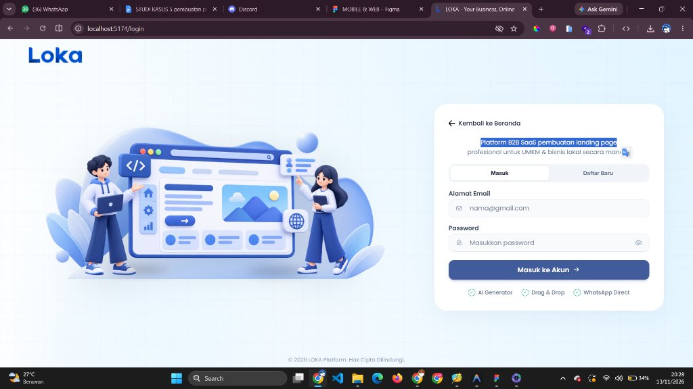
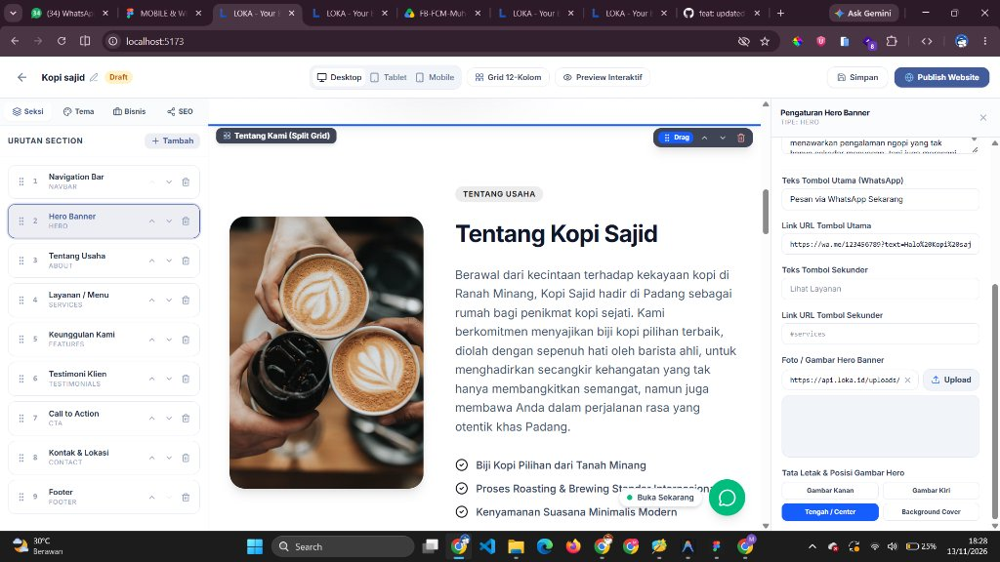
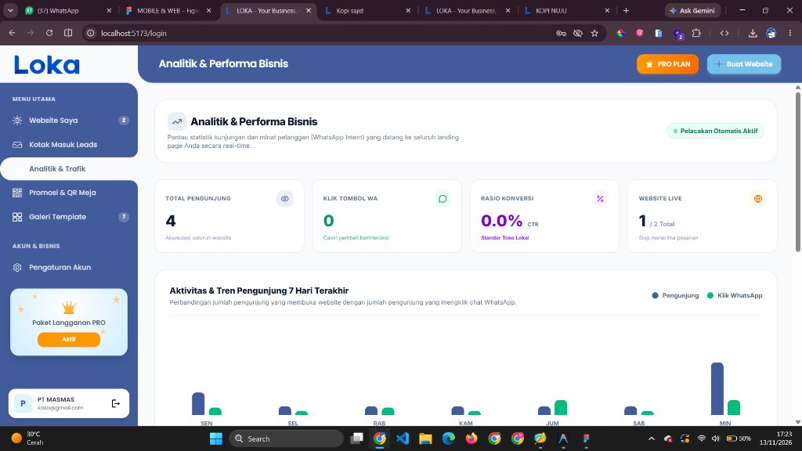
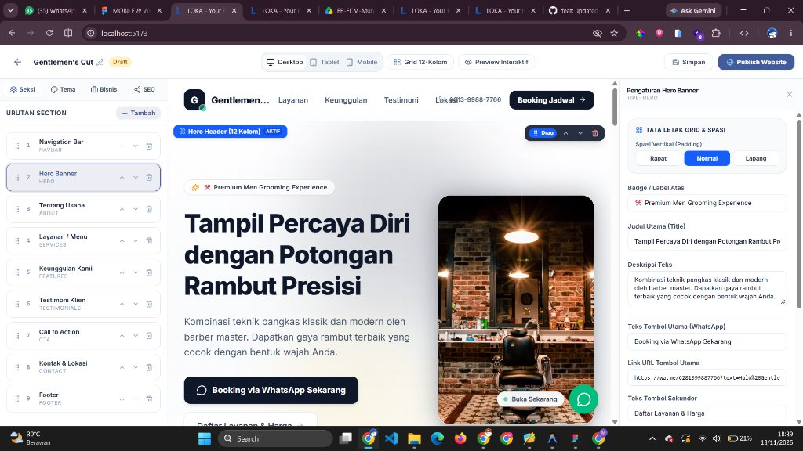
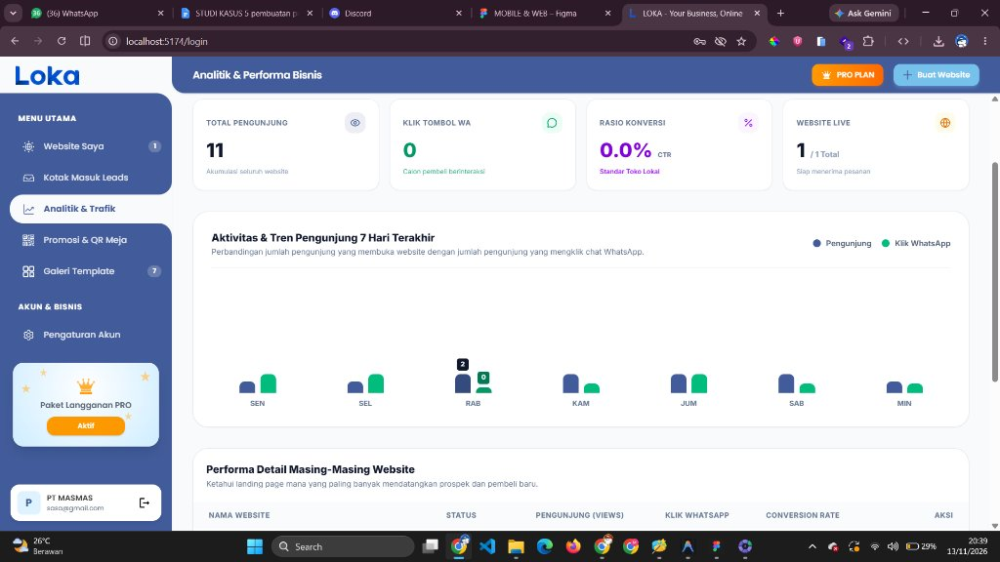
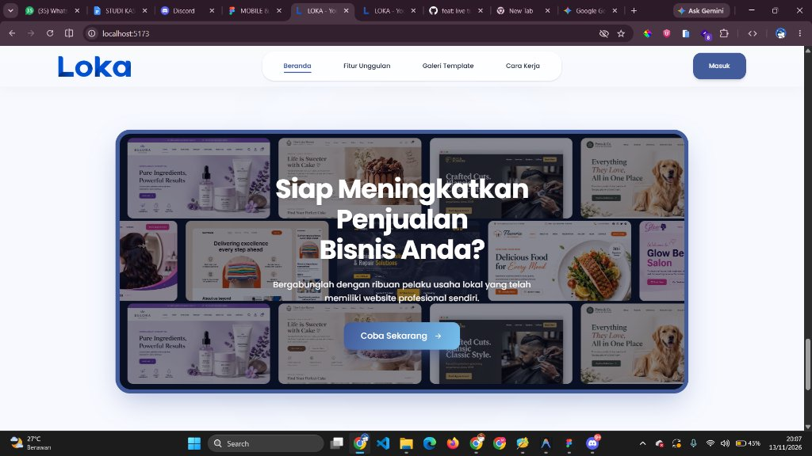

# LOKA — Platform Pembuatan Website & Landing Page Instan UMKM

> **Solusi All-in-One No-Code Website Builder & Lead Generation untuk Bisnis Lokal Indonesia.**

[](https://react.dev/)
[](https://www.typescriptlang.org/)
[](https://vitejs.dev/)
[](https://tailwindcss.com/)
[](https://nodejs.org/)
[](https://expressjs.com/)
[](https://www.postgresql.org/)

---

## Live Deployment Links

- **Frontend (Application & Landing Page)**: [https://ruuby.my.id](https://ruuby.my.id)
- **Backend API (Express & PostgreSQL)**: [https://ruubia.my.id](https://ruubia.my.id)
- **API Health Check**: [https://ruubia.my.id/api/health](https://ruubia.my.id/api/health)
- **Contoh Live Published Subdomain**: [https://kopi-senja-1861.ruuby.my.id](https://kopi-senja-1861.ruuby.my.id)

---

## Tentang Project

**Loka** adalah platform B2B SaaS (*Software as a Service*) yang dirancang khusus untuk mempermudah pelaku UMKM (*Usaha Mikro, Kecil, dan Menengah*) serta bisnis lokal di Indonesia memiliki website profil dan katalog digital profesional dalam hitungan menit tanpa keahlian koding.

Dengan antarmuka ramah pengguna (*beginner-friendly*), pemilik usaha seperti kedai kopi, barbershop, klinik kecantikan, laundry, hingga restoran dapat:

1. Memilih template desain modern atau menggunakan **AI Website Generator** berbasis Google Gemini.
2. Mengkustomisasi teks, foto, jam operasional, dan daftar layanan melalui editor visual interaktif (*drag-and-drop*).
3. Menghubungkan tombol pemesanan langsung ke **WhatsApp** bisnis pemilik usaha (*Direct Lead Generation*).
4. Menghasilkan stand **QR Code siap cetak** untuk meja kasir/meja kafe.
5. Memantau efektivitas promosi melalui dashboard analitik pengunjung secara *real-time*.
6. Mempublikasikan landing page langsung dengan subdomain bawaan otomatis (`namabisnis.ruuby.my.id`).

---

## Arsitektur Infrastruktur Production vs Lokal

| Komponen | Lingkungan Lokal (Dev) | Lingkungan Production (Live) |
|---|---|---|
| **Frontend** | Vite Dev Server (`localhost:5173`) | **Firebase Hosting** ([ruuby.my.id](https://ruuby.my.id)) |
| **Backend API** | Node.js Express (`localhost:5000`) | **Azure Virtual Machine** ([ruubia.my.id](https://ruubia.my.id) via Docker Compose) |
| **Database** | PostgreSQL Lokal / Docker Container | PostgreSQL di Azure VM (Persistent Volume) |
| **DNS, CDN & Edge** | `hosts` file / `localhost` | **Cloudflare DNS + CDN + Workers** (Subdomain router & bot OG crawler) |
| **AI Engine** | Google Gemini API | Google Gemini API |

---

## Alur Kerja Sistem (Workflow)

```
[ Registrasi / Login ]
         │
         ▼
[ Dashboard Merchant ] ────► [ Panduan Interaktif (Tour Guide) ]
         │
         ▼
[ Buat Website: AI Generator / Template Industri ]
         │
         ▼
[ Visual Editor No-Code ] ──► (Edit Teks, Foto, Tema, Jam Kerja, Tombol WA)
         │
         ▼
[ Publikasi Website (Publish) ] ──► [ Subdomain Otomatis: namabisnis.ruuby.my.id ]
         │
         ├─────────────────────────────────┬─────────────────────────────────┐
         ▼                                 ▼                                 ▼
[ Generator QR Stand Kasir ]    [ Analitik & Trafik Bisnis ]     [ Share WhatsApp (Rich Link OG) ]
```

---

## Dokumentasi Layar & Fitur Utama

### 1. Autentikasi Pengguna (Login & Register)
Pintu masuk merchant untuk mengelola seluruh ekosistem bisnis digital mereka dengan aman dan cepat.


---

### 2. Panduan Interaktif Pengguna Baru (*Onboarding Guide*)
Sistem pemandu cerdas langkah demi langkah (*walkthrough tour*) yang otomatis menyambut pengguna saat pertama kali masuk agar tidak bingung memahami menu sistem. Pengguna juga dapat memutar kembali panduan ini kapan saja melalui tombol **"Lihat Tutorial"**.


---

### 3. Dashboard Merchant ("Website Saya")
Pusat kontrol terpadu untuk melihat portofolio landing page yang dimiliki, status website (*Draft* / *Live*), link publikasi cepat, serta akses ke menu leads dan promosi.


---

### 4. Visual Editor No-Code (WYSIWYG Builder)
Editor berbasis blok seksi dengan sistem tata letak *split-grid* responsif. Merchant dapat mengubah judul, narasi bisnis, foto produk/banner, hingga menghubungkan format pesan otomatis WhatsApp hanya dengan mengisi form di panel kanan secara instan (*Live Preview*).


---

### 5. Laporan Analitik & Trafik Bisnis
Layar visualisasi metrik performa bisnis yang menampilkan data jumlah pengunjung (*views*), interaksi tombol WhatsApp (*leads*), serta rasio konversi (*CTR*) yang dilengkapi animasi grafik batang interaktif harian.


---

### 6. Landing Page & Galeri Template
Halaman depan publik Loka yang menampilkan ragam pilihan template website UMKM lokal (Kuliner, Jasa, Barbershop, Skincare, Pet Care) dan ajakan bergabung bagi para pelaku usaha.


---

## Fitur-Fitur Unggulan

| Fitur | Deskripsi |
|---|---|
| **🤖 AI Website Generator** | Generate struktur seksi, copywriting bisnis, dan tema visual secara otomatis menggunakan Google Gemini API. |
| **🎨 Visual No-Code Editor** | Pengaturan urutan seksi, tata letak konten, foto, dan warna brand secara *drag-and-drop* (`@dnd-kit`) tanpa sentuhan kode teknis. |
| **💬 WhatsApp Direct Order** | Mengarahkan calon pembeli langsung ke chat WhatsApp kasir/pemilik toko dengan pesan otomatis (*pre-filled message*). |
| **🕒 Smart Operating Hours** | Indikator buka/tutup toko otomatis real-time yang menyesuaikan waktu operasional lokal. |
| **📱 QR Meja & Kasir Instan** | Pembuatan QR Code otomatis yang dapat langsung diunduh dan dicetak untuk ditempel pada meja kafe atau kasir. |
| **🌐 Subdomain Instan & Custom OG** | Publish langsung ke `*.ruuby.my.id` dengan Cloudflare Worker untuk rich preview kartu link di WhatsApp/Telegram. |
| **📊 Dashboard Analitik Real-Time** | Memonitor tren traffic mingguan, rasio pengunjung ke pesanan, dan ranking performa website usaha. |
| **🧭 Step-by-Step Interactive Guide** | Fitur tutorial terintegrasi di Dashboard dan Editor untuk memandu UMKM pemula hingga mahir. |
| **🔒 Validasi Status Publikasi** | Halaman ramah pengguna (*not-published state*) bila tautan diakses publik saat website masih berstatus draf. |
| **👑 Paket Langganan PRO** | Opsi upgrade untuk membuka batas pembuatan website tak terbatas dan fitur analitik mendalam via Midtrans. |

---

## Tech Stack

### Frontend
- **Framework**: [React 18](https://react.dev/) + [TypeScript](https://www.typescriptlang.org/)
- **Build Tool**: [Vite 5](https://vitejs.dev/)
- **Styling**: [Tailwind CSS v4](https://tailwindcss.com/)
- **Icons**: [Lucide React](https://lucide.dev/)
- **Drag & Drop**: [@dnd-kit](https://dndkit.com/)
- **Animation**: [Framer Motion](https://www.framer.com/motion/)
- **Hosting**: Firebase Hosting

### Backend & Database
- **Runtime**: [Node.js 20 LTS](https://nodejs.org/)
- **Framework**: [Express.js](https://expressjs.com/) (Layered Clean Architecture: Route ➔ Controller ➔ Service ➔ Database)
- **Database**: [PostgreSQL 16](https://www.postgresql.org/)
- **Migrasi**: `node-pg-migrate`
- **AI Engine**: Google Gemini API
- **Deployment**: Azure Virtual Machine (Docker Compose)

### Edge & Networking
- **DNS & CDN**: Cloudflare
- **Edge Functions**: Cloudflare Workers (Wildcard subdomain routing & WhatsApp crawler OG injection)

---

## Panduan Menjalankan Project di Lokal

### Prasyarat

- **Node.js**: Versi 20.x LTS
- **npm**: Versi 10+
- **Docker Desktop** *(Disarankan)* atau **PostgreSQL 16** terpasang lokal

---

### Langkah 1: Persiapan Database PostgreSQL

#### Opsi A: Menggunakan Docker (Rekomendasi)
Jalankan container PostgreSQL melalui Docker Compose di root project:
```bash
docker compose up -d postgres
```
*Port default:* `5432`, user: `postgres`, password: `password`, database: `loka`.

#### Opsi B: Menggunakan PostgreSQL Native
Jalankan service PostgreSQL lokal Anda, lalu buat database:
```sql
CREATE DATABASE loka;
```

---

### Langkah 2: Setup & Menjalankan Backend

1. Masuk ke direktori backend:
   ```bash
   cd backend
   ```

2. Salin environment configuration:
   ```bash
   cp .env.example .env
   ```
   > Buka `.env` dan sesuaikan kredensial `DB_PASSWORD`, `DB_USER`, serta `GEMINI_API_KEY`.

3. Install dependensi:
   ```bash
   npm install
   ```

4. Jalankan migrasi database:
   ```bash
   npm run migrate up
   ```

5. Jalankan backend server:
   ```bash
   npm run dev
   ```
   - Server backend aktif di: `http://localhost:5000`
   - Health check: `http://localhost:5000/api/health`

---

### Langkah 3: Setup & Menjalankan Frontend

1. Buka terminal baru, masuk ke direktori frontend:
   ```bash
   cd frontend
   ```

2. Pastikan file `.env` mengarah ke backend lokal:
   ```env
   VITE_API_URL=http://localhost:5000
   ```

3. Install dependensi:
   ```bash
   npm install
   ```

4. Jalankan Vite development server:
   ```bash
   npm run dev
   ```
   - Aplikasi frontend aktif di: `http://localhost:5173`

---

## Perintah CLI Penting

| Perintah | Direktori | Fungsi |
|---|---|---|
| `npm run dev` | `backend/` | Menjalankan backend Express (Hot Reload) |
| `npm run migrate up` | `backend/` | Menjalankan migrasi skema tabel PostgreSQL |
| `npm run build` | `backend/` | Kompilasi TypeScript backend ke `dist/` |
| `npm run dev` | `frontend/` | Menjalankan frontend React Vite di port 5173 |
| `npm run build` | `frontend/` | Menghasilkan production bundle di `frontend/dist/` |
| `firebase deploy --only hosting` | root / `frontend/` | Deploy frontend statis ke Firebase Hosting |

---

<p align="center">
  Dibuat dengan SEMANGAT! untuk memajukan UMKM & Bisnis Lokal Indonesia.<br>
  <b>© 2026 LOKA Platform.</b>
</p>
